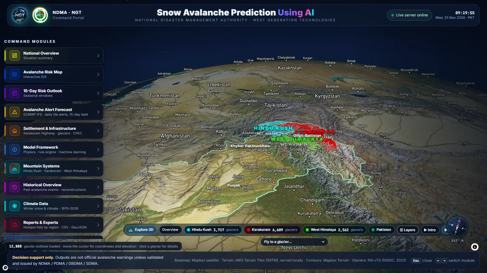
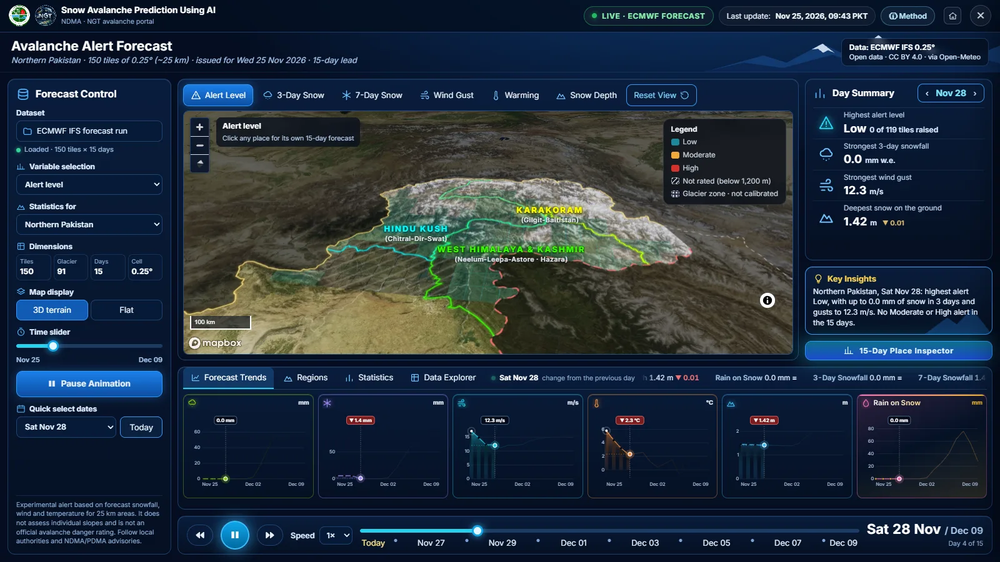
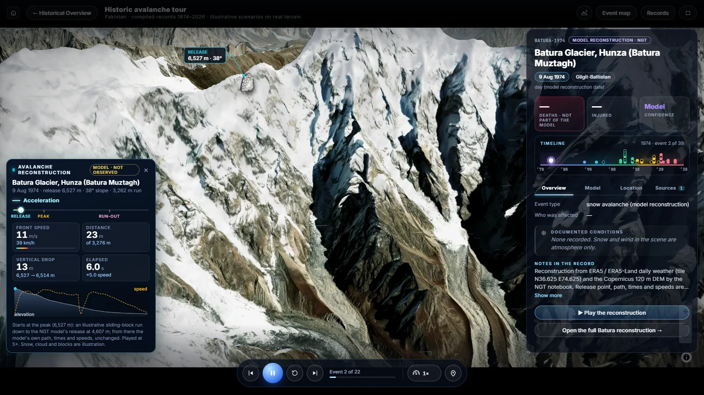
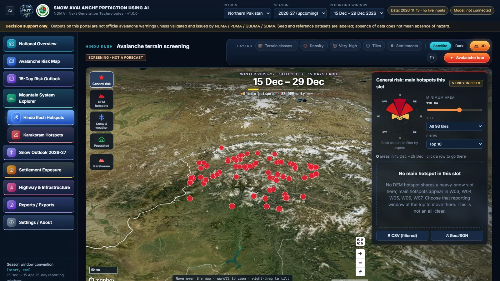
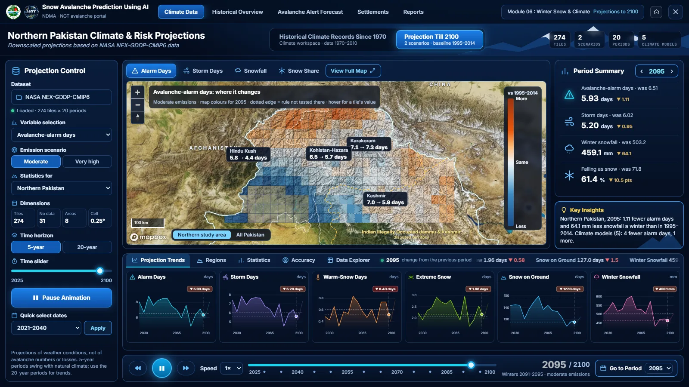
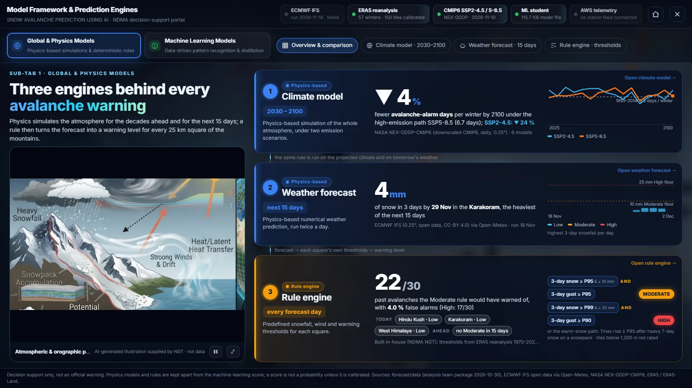
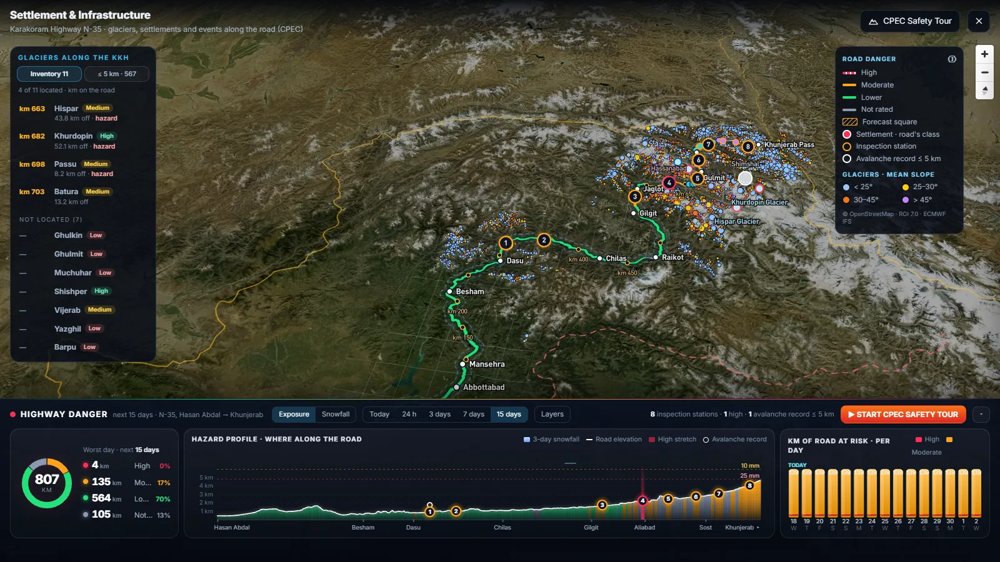

<div align="center">

&nbsp;&nbsp;

# Avalanche Prediction Portal

**AI-powered avalanche monitoring and forecasting for the glacier systems of northern Pakistan**

*“Reading glaciers before they move.”*

<a href="https://mtaha2588.github.io/Universal-Avalanche-Portal-Endgame/"></a>
&nbsp;
<a href="#run-locally"></a>

<sub>A 71-second recording of the running system, in 11 chapters. The page asks for a four-digit access code (supplied with the application).
If the page is not available, the recording itself is <a href="demo/assets/demo.mp4">demo/assets/demo.mp4</a>.</sub>

</div>

---

## Overview

A decision-support web portal built for the **National Disaster Management Authority (NDMA)** with **Next Generation
Technologies (NGT)**. It brings together glacier inventories, terrain analysis, reanalysis climate data, numerical weather
forecasts and climate projections for the Hindu Kush, Karakoram and Western Himalaya, and turns them into a 15-day
avalanche alert level for every 25 km square of the mountains.

> **Decision support only.** Outputs are not official avalanche warnings unless they are validated and issued by
> NDMA / PDMA / GBDMA / SDMA. Missing data is shown as missing, never estimated.

<p align="center"></p>

## Core capabilities

| | Capability | What it does |
|---|---|---|
| 🏔️ | **Glacier systems** | 12,888 RGI v7.0 glacier outlines (13,151 km² of ice) in the Pakistan-administered study area, grouped into Hindu Kush, Karakoram and West Himalaya on 3D satellite terrain |
| ⚠️ | **15-day Avalanche Alert Forecast** | ECMWF IFS forecasts run twice a day through a rule with each tile's own thresholds (150 tiles, 57 ERA5 winters) and a terrain danger matrix from the Copernicus DEM; machine learning as a second opinion |
| 🗺️ | **Terrain screening and hotspots** | 16,388 very-high avalanche-terrain areas from the DEM in the Hindu Kush; Karakoram hotspots; per-region hotspot registers with nearest settlement |
| 🕰️ | **Historical avalanches** | 38 compiled records (1988–2026) and the NGT model reconstruction of the 1974 Batura Glacier avalanche; 22 events replayed on the real 3D terrain in a guided tour |
| 🌡️ | **Climate** | ERA5-Land winters 1970–2010 for 305 tiles, and NASA NEX-GDDP-CMIP6 projections to 2100 under two emission scenarios, adjusted to ERA5 |
| 🛣️ | **Settlements and infrastructure** | The Karakoram Highway classed by the forecast along its length, with settlements and structures; potential exposure only |
| 🧠 | **Model framework** | Physics (weather and climate models) → rule engine → machine learning, each shown with its own sources and validation |

<table>
<tr>
<td width="50%"><br><sub><b>Avalanche Alert Forecast</b>: 150 calibrated tiles, 15-day playback, region outlines from the official glacier-region limits</sub></td>
<td width="50%"><br><sub><b>Historic avalanche tour</b>: the Batura 1974 model reconstruction replayed on 3D terrain</sub></td>
</tr>
<tr>
<td><br><sub><b>Hindu Kush terrain screening</b>: DEM hotspots combined with the seasonal snow outlook</sub></td>
<td><br><sub><b>Projections to 2100</b>: CMIP6, two scenarios, every 5-year window, with an accuracy panel</sub></td>
</tr>
<tr>
<td><br><sub><b>Model framework</b>: climate model, weather forecast and rule engine side by side</sub></td>
<td><br><sub><b>Settlements and infrastructure</b>: the Karakoram Highway and its hazard profile</sub></td>
</tr>
</table>

## Architecture

```
 Open data                     Python engine (forecast/)            Flask server (app.py)            Web portal (static/, templates/)
 ─────────────────────────     ──────────────────────────────       ─────────────────────────        ─────────────────────────────────
 ERA5 / ERA5-Land reanalysis   per-tile percentile thresholds       JSON API (/api/*)                Mapbox GL JS v3 / MapLibre 4 maps
 ECMWF IFS via Open-Meteo  ──▶ alert rule + terrain matrix     ──▶  CSV / GeoJSON exports       ──▶  CesiumJS 3D cinematic tour
 NASA NEX-GDDP-CMIP6           ML classifier (second opinion)       DEM tile cache, data catalogue   dashboards, playback, inspectors
 RGI v7.0, Copernicus DEM      scheduled runs, twice a day          Waitress WSGI server             printable situation brief
```

| Area | Files |
|---|---|
| Routes and JSON API | `app.py`, `config.py` |
| Services (windows, spatial, data store, exports, point forecast, hotspot register) | `portal/services/` |
| Forecast engine (supplied by the analysis team) | `forecast/forecast_core.py`, `terrain_core.py`, `ml_core.py`, `run_forecast.py` |
| Front page and modules | `templates/home.html`, `static/js/*.js`, `static/css/*.css` |
| Data and its catalogue (source, date, CRS, limitations, status) | `data/`, `data/catalog.json` |
| Build scripts for every imported dataset | `scripts/` |
| Tests (44) | `tests/test_portal.py` |

**Technology:** Python 3 · Flask · Waitress · pandas / NumPy / scikit-learn / rasterio (engine) · Mapbox GL JS 3.6 and
MapLibre GL 4.7 · CesiumJS 1.122 · vanilla JavaScript and CSS (no front-end framework) · pytest · Docker.

## Run locally

Windows: double-click **`run.bat`** (creates `.venv`, installs the requirements, starts the server and opens Chrome at
http://127.0.0.1:5000/). From a terminal: `.\start.cmd`.

```bash
python -m venv .venv
.venv\Scripts\activate             # macOS / Linux: source .venv/bin/activate
pip install -r requirements.txt
copy .env.example .env             # optional: MAPBOX_TOKEN (public pk.* token)
python app.py                      # http://127.0.0.1:5000  (Waitress)
python -m pytest -q tests          # 44 tests
```

The forecast engine has its own environment: `forecast\install.bat`, then `forecast\run_forecast.bat` (or
`forecast\schedule_task.bat` for the twice-daily runs). The portal reads its latest output on every request.

## The interview demo

`demo/` is a self-contained static page: a recording of the running portal with a title opening, 11 chapters, captions and
an architecture summary. It plays as a video, so nothing renders or loads while it runs: no server, Python or API keys.

| Task | Command |
|---|---|
| Re-record the film from the running portal | `python scripts/record_demo.py` (needs `websocket-client` and `imageio-ffmpeg`; records on the second monitor by default, `--screen 0,0` for the first) |
| Refresh the caption figures from the data | `.venv\Scripts\python.exe scripts/build_demo_data.py` |
| Re-take the README screenshots | `powershell -ExecutionPolicy Bypass -File scripts\demo_capture.ps1` |
| Change the access code | `python scripts/demo_set_code.py 1234` (or `off`) |
| Publish the demo to GitHub Pages | `python scripts/publish_demo.py` (pushes `demo/` to the `gh-pages` branch) |
| Preview locally | `python -m http.server 8080 -d demo`, then http://127.0.0.1:8080/ |

The access code is checked in the browser: it keeps casual visitors out but is **not security**. Nothing confidential
belongs in `demo/`.

## Deployment

- **Demo:** [GitHub Pages](https://mtaha2588.github.io/Universal-Avalanche-Portal-Endgame/) (free), served from the `gh-pages` branch, which holds `demo/` and nothing else. Update it with `python scripts/publish_demo.py`. (`deploy/github-pages-workflow.yml` does the same through Actions if your token has the `workflow` scope.)
- **Full portal:** Docker image (`Dockerfile`) on Railway (`deploy/RAILWAY.md`) or an Oracle Cloud Always Free VM with
  nginx and HTTPS (`deploy/DEPLOY.md`). Secrets (`MAPBOX_TOKEN`, `SECRET_KEY`, `OPENMETEO_APIKEY`) live in the host's
  environment, never in the repository.

## Data honesty

- Every dataset is registered in `data/catalog.json` with its source, date, resolution, limitations and status.
- Scores are labelled as indices unless they are calibrated probabilities. Terrain screening is not a forecast.
- Historical avalanche paths are illustrative scenarios on real terrain; the Batura 1974 path is a model reconstruction.
- Roads are never stated to be closed: "potential exposure, requires verification".
- Political boundaries come from Natural Earth (Pakistan view); Jammu & Kashmir is shown as disputed and the Line of
  Control dashed.

## Data sources

RGI 7.0 Consortium (2023), Randolph Glacier Inventory v7.0, NSIDC · GTN-G glacier regions (2023) · ECMWF IFS open data
(CC BY 4.0) via Open-Meteo · ERA5 / ERA5-Land (Copernicus Climate Change Service) · NASA NEX-GDDP-CMIP6 (CC0) ·
Copernicus DEM GLO-30 / GLO-90 (© DLR e.V. and © Airbus Defence and Space GmbH, provided under COPERNICUS by the EU and
ESA) · AWS Terrain Tiles (SRTM) · Natural Earth · OpenStreetMap contributors (ODbL) · Esri and Mapbox imagery.
